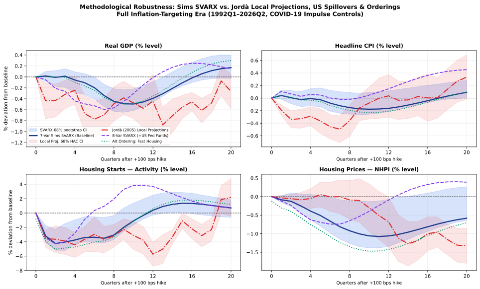

# Monetary Policy Transmission Lags in Canada

[](https://github.com/ArthurKaan/Monetary-Policy-Transmission-Lags-in-Canada/actions/workflows/ci.yml)


Quantifying how unexpected **Bank of Canada overnight rate shocks** transmit through Canada's **housing market (construction volume vs. new-home prices)**, **real output (GDP)**, **headline inflation (CPI)**, and the **USD/CAD exchange rate** over the full inflation-targeting era (`1992Q1–2026Q2`).

> **Core Research Question:** When the Bank of Canada unexpectedly hikes the overnight rate by **+100 bps**, how many quarters does it take for the shock to peak in the **housing market** versus **headline inflation**, and how much of that macroeconomic volatility is actually driven by monetary policy?


---

## Executive Summary

Using a **7-variable Sims (1992) Small-Open-Economy Structural VARX** (`[BCPI, Real GDP, Headline CPI, Housing Starts, NHPI, Overnight Rate, USD/CAD]` with COVID-19 impulse controls) cross-checked via **Jordà (2005) Local Projections**, **US Federal Funds spillover controls**, and **alternative Cholesky orderings**:

1. **Housing Reacts Through Two Distinct Speeds:**
   - **Housing Volume (CMHC Starts) is the fastest transmission channel**, plunging **-4.25%** within **2 quarters** (`Q2`, statistically significant; **-12.4 pp annualized growth** on impact in the stationary VARX).
   - **Housing Prices (NHPI) absorb the deepest cumulative price hit**, falling **-1.08%** by **Q11** (~2.75 years)—roughly **6× deeper than headline CPI**—due to new-home pre-sale contract inertia.
2. **Output & Headline Inflation Peak Around 2.5 Years (No Price Puzzle):**
   - Ordering the **Bank of Canada Commodity Price Index (BCPI)** first resolves the textbook short-run price puzzle. Following a +100 bps hike, **Real GDP** contracts **-0.50% at Q10** (virtually identical to **-0.49% at Q10** pre-COVID) and **Headline CPI** declines **-0.18% at Q10** (**-0.15% at Q9** pre-COVID).
3. **Monetary Policy's Share of Volatility (FEVD):**
   - Over 3–5 years (`Q12–Q20`), unexpected Bank of Canada policy shocks explain **7.9%–8.5% of Housing Starts**, **5.5%–6.2% of Real GDP** (**9.8%** pre-COVID), **3.2%–4.5% of Housing Prices (NHPI)**, and **1.0% of Headline CPI** (**4.7%** pre-COVID, confirming that exogenous post-2020 global supply shocks dominated recent inflation variance).

---

## Key Empirical Results (+100 bps Overnight Rate Hike)

### 1. Flagship 7-Variable Sims (1992) SOE SVARX (`p = 4`, Detrended Log-Levels)

| Sample | Target Variable | Peak Trough | Peak Response | 68% CI Negative? | FEVD (Q4) | FEVD (Q12) | FEVD (Q20) |
| :--- | :--- | :---: | :---: | :---: | :---: | :---: | :---: |
| **Full Era (`1992Q1–2026Q2`, COVID Ctrl)** | Housing Starts (CMHC) | **Q2** | **-4.25%** | Yes | 5.6% | 8.5% | 7.9% |
| **Full Era (`1992Q1–2026Q2`, COVID Ctrl)** | Real GDP | **Q10** | **-0.50%** | Yes | 0.0% | 6.2% | 5.5% |
| **Full Era (`1992Q1–2026Q2`, COVID Ctrl)** | Headline CPI | **Q10** | **-0.18%** | No | 0.0% | 0.9% | 1.0% |
| **Full Era (`1992Q1–2026Q2`, COVID Ctrl)** | Housing Prices (NHPI) | **Q11** | **-1.08%** | Yes | 0.3% | 3.2% | 4.5% |
| **Pre-COVID (`1992Q1–2019Q4`)** | Housing Starts (CMHC) | **Q2** | **-2.16%** | Yes | 1.5% | 1.5% | 1.5% |
| **Pre-COVID (`1992Q1–2019Q4`)** | Real GDP | **Q10** | **-0.49%** | Yes | 3.5% | 9.7% | 9.8% |
| **Pre-COVID (`1992Q1–2019Q4`)** | Headline CPI | **Q9** | **-0.15%** | Yes | 0.4% | 2.7% | 4.7% |
| **Pre-COVID (`1992Q1–2019Q4`)** | Housing Prices (NHPI) | **Q20** | **-0.69%** | Yes | 0.5% | 0.6% | 2.2% |

*(Companion stability holds across every model: `max eig = 0.984` full levels, `0.962` pre-COVID levels, `0.903` full stationary with Portmanteau whiteness `p = 0.066`, `0.895` pre-COVID stationary with whiteness `p = 0.065`.)*

---

### 2. Methodological Triangulation & Robustness

To verify that transmission lags are not artifacts of VAR linearity, US monetary policy spillovers, or Cholesky ordering, `src/robustness.py` benchmarks the flagship SVARX against three independent alternatives:



| Methodology (`1992Q1–2026Q2`) | Housing Starts Trough | Real GDP Trough | Headline CPI Trough | Housing Prices (NHPI) Trough |
| :--- | :---: | :---: | :---: | :---: |
| **7-Var Sims SVARX (Baseline)** | **Q2 (`-4.25%`)** | **Q10 (`-0.50%`)** | **Q10 (`-0.18%`)** | **Q11 (`-1.08%`)** |
| **Jordà (2005) Local Projections (HAC)** | **Q4 (`-4.44%`)** / Q12 (`-5.73%`) | **Q8 (`-0.49%`)** / Q13 (`-0.88%`) | **Q7 (`-0.49%`)** | **Q12 (`-0.68%`)** / Q20 (`-1.33%`) |
| **8-Var SVARX (+US Fed Funds Block)** | **Q2 (`-4.29%`)** | **Q7 (`-0.59%`)** | **Q8 (`-0.02%`)** | **Q7 (`-0.74%`)** |
| **Alt Cholesky Ordering (Fast Housing)** | **Q2 (`-5.03%`)** | **Q9 (`-0.50%`)** | **Q10 (`-0.23%`)** | **Q10 (`-1.47%`)** |

---

## Data Sources (100% Keyless Official APIs)

| Variable | Source | Series / Vector ID | Role in Model |
| :--- | :--- | :--- | :--- |
| **Real GDP** | Statistics Canada WDS (`36-10-0104-01`) | `v62305752` | Quarterly output (chained 2017 $, SAAR) |
| **Headline CPI** | Statistics Canada WDS (`18-10-0006-01`) | `v41690914` | Monthly SA All-items price index |
| **Housing Starts** | Statistics Canada WDS (`34-10-0158-01`) | `v52300157` | Monthly CMHC housing starts, Canada SAAR |
| **Housing Prices (NHPI)** | Statistics Canada WDS (`18-10-0205-01`) | `v111955442` | Monthly New Housing Price Index (house & land) |
| **Overnight Policy Rate** | Bank of Canada Valet API | `V39079`, `V122514`, `V122530` | Continuous spliced policy rate (`1992–2026`) |
| **USD/CAD Exchange Rate** | StatCan WDS + BoC Valet API | `v37426` + `FXMUSDCAD` | Spliced monthly average (`max overlap diff = 0.00039`) |
| **Commodity Price Index** | Bank of Canada Valet API | `M.BCPI` | Sims (1992) forward-looking global inflation control |
| **US Federal Funds Rate** | FRED (keyless CSV) | `FEDFUNDS` | Small-open-economy US monetary spillover control |

---

## Econometric Design

1. **Frequency Alignment & Splicing (`src/preprocess.py`):** Daily/monthly series are spliced with explicit overlap diagnostics and aggregated to complete quarterly averages (`1992Q1–2026Q2`, 138 quarters). Both **ADF** and **KPSS** tests confirm I(1) levels and I(0) QoQ growth rates.
2. **Sims (1992) + COVID-Controlled SVARX (`src/estimate_var.py`):**
   - Recursive Cholesky ordering from global/slow variables to policy and fast financial prices: `[BCPI, Real GDP, Headline CPI, Housing Starts, NHPI, Overnight Rate, USD/CAD]`.
   - Estimated in **detrended log-levels (`trend="ct"`, Sims–Stock–Watson 1990)** and cross-checked in **stationary growth rates (`trend="c"`)**.
   - Exogenous `covid_2020q2` and `covid_2020q3` impulse dummies absorb pandemic lockdown outliers so the 2022–2024 BoC hiking cycle informs the estimates cleanly.
   - Uncertainty quantified via **1,000-replication nonparametric residual bootstrap** (68% and 90% bands), normalized to a **+100 bps (+1.0 pp)** impact policy shock.
3. **Methodological Triangulation (`src/robustness.py`):** Compares SVARX IRFs against **Jordà (2005) Local Projections** with **Newey–West HAC** standard errors (Plagborg-Møller & Wolf, 2021), an 8-variable US Fed Funds spillover block, and a fast-housing Cholesky ordering.

---

## Repository Structure

```text
├── src/
│   ├── fetch_data.py         # Keyless StatCan WDS + Bank of Canada Valet + FRED ingestion
│   ├── preprocess.py         # Series splicing, quarterly alignment, COVID dummies, ADF/KPSS
│   ├── estimate_var.py       # 7-var Sims SOE SVARX, residual bootstrap IRFs, FEVD & charts
│   └── robustness.py         # Jordà (2005) Local Projections (HAC), US spillovers & orderings
├── notebooks/
│   └── exploratory_irf.ipynb # Pre-executed notebook with inline charts & diagnostic tables
├── tests/
│   └── test_pipeline.py      # Pytest unit & econometric invariant tests (CI-verified)
├── figures/                  # Exported SVG & PNG publication-ready charts
├── data/
│   ├── raw/                  # Raw API downloads (ignored in git; rebuilt via fetch_data.py)
│   └── processed/            # Quarterly panels, stationarity diagnostics & SVARX/LP results
├── .github/workflows/ci.yml  # Automated pytest CI workflow
└── requirements.txt
```

---

## Quickstart & Testing

```bash
pip install -r requirements.txt

# 1. Fetch live data from Statistics Canada, Bank of Canada Valet, and FRED
python src/fetch_data.py

# 2. Align to quarterly frequency, add COVID controls & run ADF/KPSS tests
python src/preprocess.py

# 3. Estimate full & pre-COVID SVARX models, bootstrap IRFs, FEVD & charts
python src/estimate_var.py

# 4. Run Jordà (2005) Local Projections, US spillover & ordering robustness checks
python src/robustness.py

# 5. Run unit & econometric invariant tests
pytest
```
