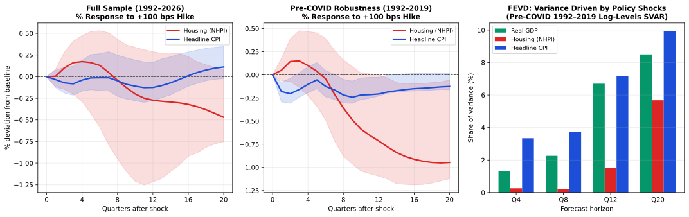

# Monetary Policy Transmission Lags in Canada

Quantifying the dynamic impact of unexpected **Bank of Canada overnight rate shocks** on Canadian **real output (GDP)**, **headline inflation (CPI)**, **housing prices (NHPI)**, and the **USD/CAD exchange rate**.

> **Core Research Question:** When the Bank of Canada unexpectedly hikes the overnight rate by +100 bps, how many quarters does it take for the shock to peak in the housing market versus headline inflation, and how much of that volatility is actually driven by monetary policy?



---

## Key Empirical Findings

Estimated via a **5-variable open-economy Cholesky SVAR** (`Real GDP → Headline CPI → Housing NHPI → Overnight Rate → USD/CAD`) across both the **full inflation-targeting era (`1992Q1–2026Q2`, T = 138)** and a **pre-COVID robustness sample (`1992Q1–2019Q4`, T = 112)** with 1,000 residual bootstrap replications:

| Model (Detrended Log-Levels, `p = 5`) | Target Variable | Peak Trough (Quarter) | Peak Response per +100 bps Hike | 68% CI Negative? | FEVD at Q12 | FEVD at Q20 |
| :--- | :--- | :---: | :---: | :---: | :---: | :---: |
| **Pre-COVID (`1992Q1–2019Q4`)** | Real GDP | **Q9** | **-0.45%** | Yes | 6.7% | 8.5% |
| **Pre-COVID (`1992Q1–2019Q4`)** | Headline CPI | **Q9** | **-0.24%** | Yes | 7.2% | 9.9% |
| **Pre-COVID (`1992Q1–2019Q4`)** | Housing (NHPI) | **Q19** | **-0.95%** | Yes | 1.5% | 5.7% |
| **Full Era (`1992Q1–2026Q2`)** | Real GDP | **Q11** | **-0.63%** | Yes | 4.7% | 5.8% |
| **Full Era (`1992Q1–2026Q2`)** | Headline CPI | **Q11** | **-0.13%** | No | 0.4% | 0.5% |
| **Full Era (`1992Q1–2026Q2`)** | Housing (NHPI) | **Q20** | **-0.47%** | No | 0.2% | 0.7% |

### Headline Insights
1. **Eliminating the Price Puzzle:** Incorporating the **USD/CAD exchange rate** in an open-economy specification removes the textbook price puzzle—headline CPI declines cleanly after an unexpected rate hike, peaking around **9–11 quarters** (~2–2.5 years).
2. **Housing Reacts ~4× Deeper than CPI, with Longer Price-Level Inertia:** In the pre-COVID baseline, a +100 bps hike cuts New Housing Prices by **-0.95%** versus **-0.24%** for headline CPI. While housing *growth rates* begin decelerating within **4 quarters** (stationary VAR), the cumulative NHPI *price level* continues grinding down through **Q19–Q20** due to new-home pre-sale contract inertia.
3. **Policy's Share of Macro Volatility (FEVD):** During the pre-COVID inflation-targeting era, unexpected Bank of Canada policy shocks accounted for **~6%–10%** of 5-year variance in GDP, CPI, and NHPI (and **15.2%** of USD/CAD). Extending through **2020–2026** cuts CPI and NHPI FEVD shares below 1%, showing that exogenous pandemic and global supply shocks dominated post-2020 price volatility.

---

## Data Sources (100% Keyless Public APIs)

| Variable | Source | Series / Vector ID | Notes |
| :--- | :--- | :--- | :--- |
| **Real GDP** | Statistics Canada WDS (`36-10-0104-01`) | `v62305752` | Quarterly, chained 2017 dollars, SAAR |
| **Headline CPI** | Statistics Canada WDS (`18-10-0006-01`) | `v41690914` | Monthly, All-items Canada, seasonally adjusted |
| **Housing Prices (NHPI)** | Statistics Canada WDS (`18-10-0205-01`) | `v111955442` | Monthly, Total (house & land), Canada |
| **Overnight Policy Rate** | Bank of Canada Valet API | `V39079`, `V122514`, `V122530` | Spliced daily Target Rate (2009+), monthly MMF (1996–2009), Bank Rate − 25 bps (1992–1995) |
| **USD/CAD Exchange Rate** | StatCan WDS + BoC Valet API | `v37426` + `FXMUSDCAD` | Spliced monthly average (max overlap diff `0.00039` on Jan–Apr 2017) |

---

## Methodology

1. **Frequency Alignment & Splicing (`src/preprocess.py`):** Daily and monthly indicators are aggregated to complete quarterly averages (`1992Q1`–`2026Q2`) and verified for splice continuity.
2. **Stationarity Diagnostics (`src/preprocess.py`):** Runs **ADF** and **KPSS** tests on both log-levels (`I(1)`) and QoQ annualized growth rates (`I(0)`).
3. **Structural Identification (`src/estimate_var.py`):**
   - Recursive Cholesky ordering from slow-moving macro quantities/prices to fast-moving financial prices:  
     `[Real GDP, Headline CPI, Housing (NHPI), Overnight Rate, USD/CAD]`
   - Estimates both **detrended log-levels SVARs** (`trend="ct"`, Sims-Stock-Watson / CEE) and **stationary growth-rate SVARs** (`trend="c"`).
   - Selects lag order via **FPE** (verified against AIC, BIC, HQIC), checks companion-matrix stability and Portmanteau residual whiteness, and computes **68% & 90% residual bootstrap confidence bands** (1,000 draws).

---

## Repository Structure

```text
├── src/
│   ├── fetch_data.py        # Keyless StatCan WDS + Bank of Canada Valet ingestion
│   ├── preprocess.py        # Splicing, quarterly alignment, ADF & KPSS stationarity tests
│   └── estimate_var.py      # 5-var SVAR estimation, bootstrap IRFs, FEVD & charts
├── notebooks/
│   └── exploratory_irf.ipynb # Interactive exploratory analysis, diagnostics & plots
├── data/
│   ├── raw/                 # Downloaded raw API CSVs & metadata.json
│   └── processed/           # Quarterly panels, stationarity report & SVAR results/
├── figures/                 # Exported IRF & FEVD publication-ready figures
└── requirements.txt
```

---

## Quickstart

```bash
pip install -r requirements.txt

# 1. Fetch latest live data from StatCan & Bank of Canada APIs
python src/fetch_data.py

# 2. Align to quarterly frequency & run ADF/KPSS stationarity diagnostics
python src/preprocess.py

# 3. Estimate full & pre-COVID SVARs, bootstrap IRFs, compute FEVD & save charts
python src/estimate_var.py
```
